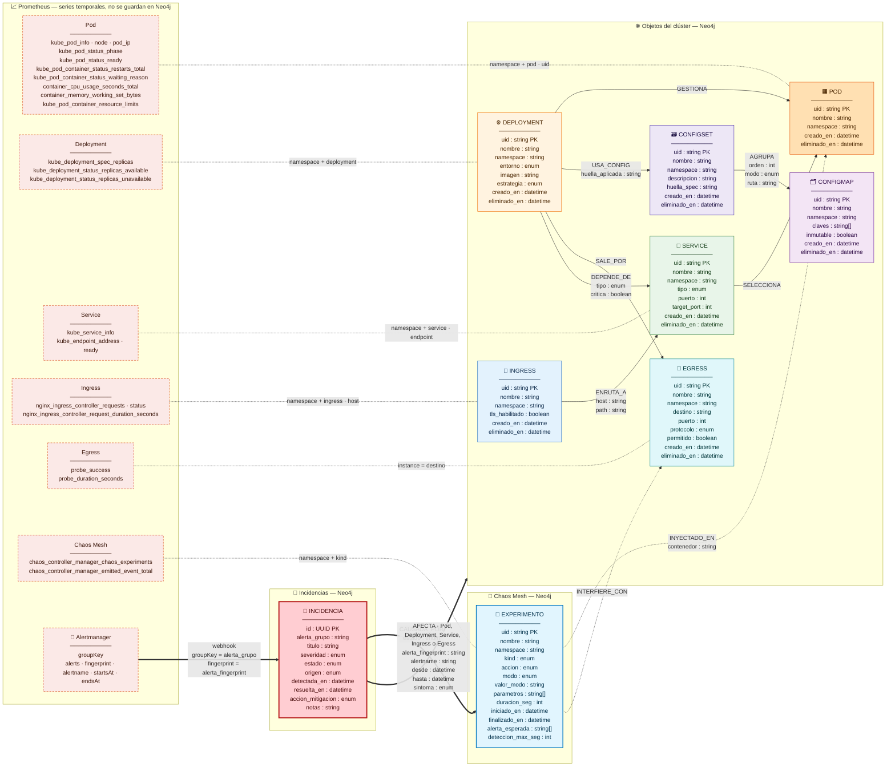

# Esquema de grafo — Incidencias en ambiente de pruebas con Chaos Engineering (v4)

## Contexto

En el ambiente de pruebas las incidencias **no se originan en commits**: las provocan experimentos de **Chaos Mesh** (matar Pods, inyectar latencia, saturar CPU…). El objetivo del grafo es **validar el método de detección y almacenamiento**:

- **Causa:** cada falla inyectada queda como nodo `Experimento`.
- **Efecto:** Prometheus detecta la falla, Alertmanager la reporta y el ingestor crea la `Incidencia`.
- **Validación:** el grafo correlaciona causa y efecto y mide si se detectó, cuánto tardó y si el sistema se recuperó solo.

**Reparto de responsabilidades**

| Capa           | Guarda                                                                                    |
| -------------- | ----------------------------------------------------------------------------------------- |
| **Neo4j**      | Identidad y topología del clúster, experimentos, incidencias y la correlación entre ellos |
| **Prometheus** | Estado y comportamiento en el tiempo (fase, readiness, CPU, latencia, sondas de egress)   |

---

## Diagrama 1 — Esquema



**Leyenda:**

- `──▶` dependencia estructural.
- `┄┄▶` inyección de falla (causa).
- `━━▶` detección y correlación (efecto).
- `┄┄┄` correlación por label, sin arista en Neo4j.

## Diagrama 2 — Cómo se alimenta el grafo

```mermaid
flowchart LR
    OPE(["👤 Operador o Schedule de Chaos Mesh"]) --> CRD["Recurso Chaos Mesh<br/>PodChaos · NetworkChaos · StressChaos<br/>anotaciones: alerta esperada · detección máx"]
    CRD --> CTRL["chaos-controller-manager"]
    CTRL --> DAEMON["chaos-daemon · por nodo"]
    DAEMON -->|"inyecta falla"| WORK["Pods en namespace chaos-test"]
    LOAD["Generador de tráfico<br/>k6 / Locust"] -->|"tráfico sintético"| WORK

    WORK -->|"kube-state-metrics · cAdvisor<br/>ingress-nginx · blackbox_exporter"| PROMS["Prometheus"]
    CTRL -->|"métricas chaos_controller_manager"| PROMS
    PROMS -->|"reglas de alerta"| ALERT["Alertmanager"]
    ALERT -->|"webhook"| INGEST["Ingestor de incidencias"]
    INGEST -->|"MERGE Incidencia · AFECTA<br/>correlaciona CAUSADA_POR"| NEO[("Neo4j")]

    CRD -->|"watch status.experiment"| COLX["Colector de experimentos"]
    COLX -->|"MERGE Experimento<br/>INYECTADO_EN · INTERFIERE_CON"| NEO
    WORK -->|"watch API de Kubernetes"| COLK["Colector de inventario"]
    COLK -->|"MERGE objetos y relaciones<br/>eliminado_en al borrar"| NEO

    NEO --> VAL["Consultas de validación<br/>detectado · MTTD · recuperación · cobertura"]
    PROMS --> GRAF["Grafana<br/>anotaciones de experimentos"]

    classDef chaos fill:#E1F5FE,stroke:#0277BD,color:#01304A
    classDef obs fill:#FBE9E7,stroke:#D84315,color:#3E1A0E
    classDef store fill:#E8F5E9,stroke:#2E7D32,color:#123B16
    classDef app fill:#FFF3E0,stroke:#EF6C00,color:#4A2600

    class OPE,CRD,CTRL,DAEMON chaos
    class PROMS,ALERT,GRAF obs
    class INGEST,COLX,COLK,NEO,VAL store
    class WORK,LOAD app
```



---

## 1. Cambios v3 → v4

| Cambio                                                                                                               | Motivo                                                                                                                                                        |
| -------------------------------------------------------------------------------------------------------------------- | ------------------------------------------------------------------------------------------------------------------------------------------------------------- |
| **Se elimina el nodo `Commit`** y sus relaciones `MODIFICA`, `REVIERTE`, `EJECUTA`, `DESPLEGADO_EN` y `MITIGADA_POR` | En este diseño el grafo no se alimenta por commits                                                                                                            |
| **Se elimina `huella_spec`** de Ingress, Service, Deployment, ConfigMap y Egress                                     | Su único propósito era compararlo con `MODIFICA.huella_resultante`. Se mantiene en ConfigSet porque `USA_CONFIG.huella_aplicada` sigue comparándose contra él |
| **Nuevo nodo `Experimento`**                                                                                         | Es la causa de la incidencia en pruebas                                                                                                                       |
| **Nuevas relaciones `INYECTADO_EN` e `INTERFIERE_CON`**                                                              | Qué Pods y qué destinos externos tocó la falla                                                                                                                |
| **`CAUSADA_POR` apunta a `Experimento`**                                                                             | La causa ya no es un commit                                                                                                                                   |
| **`AFECTA` se generaliza** a Pod, Deployment, Service, Ingress o Egress                                              | Una alerta de latencia trae label `ingress` y no `pod`; un pod-kill se detecta en el Deployment                                                               |
| **`AFECTA.alertname`** (nuevo)                                                                                       | Necesario para comparar contra `Experimento.alerta_esperada`                                                                                                  |
| Incidencia: se quitan `mitigada_en`, `pods_afectados`, `descripcion`, `causa_raiz`, `reportada_por` y `asignada_a`   | `mitigada_en` = `max(AFECTA.hasta)`. La causa es la relación. `descripcion` y `causa_raiz` se unifican en `notas`. El origen pasa a `origen`                  |
| `Deployment.entorno` incorpora el valor `pruebas`                                                                    | Filtra el namespace de caos                                                                                                                                   |

---

## 2. Diccionario — nodo Experimento

Se carga desde el recurso de Chaos Mesh (`PodChaos`, `NetworkChaos`, `StressChaos`).

| Atributo              | Tipo                                                                                               | Fuente                                             | Propósito                                                            |
| --------------------- | -------------------------------------------------------------------------------------------------- | -------------------------------------------------- | -------------------------------------------------------------------- |
| `uid`                 | string                                                                                             | `metadata.uid`                                     | Clave única para `MERGE`                                             |
| `nombre`, `namespace` | string                                                                                             | `metadata`                                         | Identificación y correlación con métricas de Chaos Mesh              |
| `kind`                | enum PodChaos · NetworkChaos · StressChaos                                                         | `kind`                                             | Tipo de falla, para agrupar resultados                               |
| `accion`              | enum pod-kill · pod-failure · container-kill · delay · loss · partition · bandwidth · cpu · memory | `spec.action` (StressChaos: según `stressors`)     | Falla concreta; define qué alerta debería disparar                   |
| `modo`                | enum one · all · fixed · fixed-percent · random-max-percent                                        | `spec.mode`                                        | Cuántos Pods se afectan, lo que fija el radio de impacto esperado    |
| `valor_modo`          | string                                                                                             | `spec.value`                                       | Cantidad o porcentaje del modo                                       |
| `parametros`          | string[]                                                                                           | `spec.delay`, `spec.stressors`… como `clave=valor` | Reproducir el experimento, por ejemplo `latency=200ms` o `workers=2` |
| `duracion_seg`        | int                                                                                                | `spec.duration`                                    | Ventana de inyección planificada                                     |
| `iniciado_en`         | datetime                                                                                           | Estado del recurso                                 | Inicio real; base para calcular el MTTD                              |
| `finalizado_en`       | datetime                                                                                           | Estado del recurso                                 | Fin real; ventana de correlación y base de la recuperación           |
| `alerta_esperada`     | string[]                                                                                           | Anotación `pruebas/alerta-esperada`                | **Aserción de la prueba:** qué alertas deben disparar                |
| `deteccion_max_seg`   | int                                                                                                | Anotación `pruebas/deteccion-max-seg`              | **SLO de detección** que la prueba debe cumplir                      |

El resultado de la prueba (detectado, no detectado o detectado tarde) **no se almacena**: se calcula con la consulta V1.

## 3. Diccionario — resto de nodos

| Nodo       | Atributos                                                                                           | Propósito                                                                                                                       |
| ---------- | --------------------------------------------------------------------------------------------------- | ------------------------------------------------------------------------------------------------------------------------------- |
| Comunes    | `uid`, `nombre`, `namespace`, `creado_en`, `eliminado_en`                                           | Identidad y correlación con Prometheus. `eliminado_en` conserva los Pods matados por un pod-kill para seguir correlacionándolos |
| Ingress    | `tls_habilitado`                                                                                    | Diagnosticar fallas de certificado                                                                                              |
| Service    | `tipo`, `puerto`, `target_port`                                                                     | Exposición y desajustes de puerto                                                                                               |
| Deployment | `entorno`, `imagen`, `estrategia`                                                                   | Filtrar `pruebas`, saber qué versión se probó y si una falla tira todos los Pods (Recreate)                                     |
| Pod        | —                                                                                                   | Ancla de `INYECTADO_EN`, `AFECTA` y `SELECCIONA`                                                                                |
| ConfigSet  | `descripcion`, `huella_spec`                                                                        | Documentación y comparación con `USA_CONFIG.huella_aplicada`                                                                    |
| ConfigMap  | `claves`, `inmutable`                                                                               | Qué variables contiene y si cambiarlo obliga a recrearlo                                                                        |
| Egress     | `destino`, `puerto`, `protocolo`, `permitido`                                                       | Regla de salida. `destino` correlaciona con `probe_success` y con `externalTargets` del NetworkChaos                            |
| Incidencia | `id`, `alerta_grupo`                                                                                | Clave e idempotencia con Alertmanager                                                                                           |
| Incidencia | `titulo`, `severidad`, `estado` (abierta · en_analisis · cerrada), `origen` (alertmanager · manual) | Reporte. `origen = manual` indica una falla que el monitoreo no detectó                                                         |
| Incidencia | `detectada_en`, `resuelta_en`                                                                       | MTTD (contra `Experimento.iniciado_en`) y cierre del análisis                                                                   |
| Incidencia | `accion_mitigacion` (autorecuperacion · fin_experimento · intervencion_manual)                      | Indica si el sistema se recuperó solo                                                                                           |
| Incidencia | `notas`                                                                                             | Narrativa del análisis                                                                                                          |

## 4. Diccionario — relaciones

| Relación         | Origen → Destino                                           | Atributos                                                      | Propósito                                                                                                                                       |
| ---------------- | ---------------------------------------------------------- | -------------------------------------------------------------- | ----------------------------------------------------------------------------------------------------------------------------------------------- |
| `ENRUTA_A`       | Ingress → Service                                          | `host`, `path`                                                 | Propagar el impacto a hosts públicos                                                                                                            |
| `SELECCIONA`     | Service → Pod                                              | —                                                              | Propagar el impacto de Pod a Service                                                                                                            |
| `GESTIONA`       | Deployment → Pod                                           | —                                                              | Correlacionar un pod-kill con la alerta del Deployment                                                                                          |
| `USA_CONFIG`     | Deployment → ConfigSet                                     | `huella_aplicada`                                              | Detectar config desactualizada                                                                                                                  |
| `AGRUPA`         | ConfigSet → ConfigMap                                      | `orden`, `modo`, `ruta`                                        | Precedencia y forma de montaje                                                                                                                  |
| `SALE_POR`       | Deployment → Egress                                        | —                                                              | Qué workloads sufren si un destino externo falla                                                                                                |
| `DEPENDE_DE`     | Deployment → Service                                       | `tipo`, `critica`                                              | Impacto esperado en cascada. Solo las aristas con `critica = true` participan en la correlación (rama 4) y en el radio de impacto predicho (V5) |
| `INYECTADO_EN`   | Experimento → Pod                                          | `contenedor`                                                   | Pods y contenedores reales que tocó la falla (`status.experiment.containerRecords`)                                                             |
| `INTERFIERE_CON` | Experimento → Egress                                       | —                                                              | Destinos externos afectados (`spec.externalTargets` de NetworkChaos)                                                                            |
| `AFECTA`         | Incidencia → Pod · Deployment · Service · Ingress · Egress | `alerta_fingerprint`, `alertname`, `desde`, `hasta`, `sintoma` | Dónde y cuándo se detectó. `sintoma` es la razón de Kubernetes, por ejemplo CrashLoopBackOff u OOMKilled                                        |
| `CAUSADA_POR`    | Incidencia → Experimento                                   | `estado` (correlacionada · confirmada · descartada)            | `correlacionada` la asigna el ingestor y el analista la confirma o descarta                                                                     |

---

## 5. Catálogo de experimentos → detección esperada

| Experimento                                  | `kind` / `accion`                       | Alerta esperada                          | Nodo que recibe `AFECTA` |
| -------------------------------------------- | --------------------------------------- | ---------------------------------------- | ------------------------ |
| Matar un Pod al azar                         | PodChaos / pod-kill, `modo: one`        | `DeploymentReplicasNoDisponibles`        | Deployment               |
| Pod sin responder                            | PodChaos / pod-failure                  | `PodNoListo`                             | Pod                      |
| Matar contenedor                             | PodChaos / container-kill               | `PodNoListo`, `PodEnError`               | Pod                      |
| Latencia de red                              | NetworkChaos / delay                    | `LatenciaIngresoAlta`                    | Ingress                  |
| Pérdida de paquetes hacia un destino externo | NetworkChaos / loss + `externalTargets` | `EgressInalcanzable`                     | Egress                   |
| Saturar CPU                                  | StressChaos / cpu                       | `CPUSaturada`                            | Pod                      |
| Presión de memoria                           | StressChaos / memory                    | `MemoriaAlta` o `PodEnError` (OOMKilled) | Pod                      |

### Ejemplo de experimento con su aserción

```yaml
apiVersion: chaos-mesh.org/v1alpha1
kind: PodChaos
metadata:
  name: matar-pod-api
  namespace: chaos-test
  annotations:
    pruebas/alerta-esperada: "DeploymentReplicasNoDisponibles"
    pruebas/deteccion-max-seg: "120"
spec:
  action: pod-kill
  mode: one
  selector:
    namespaces: [chaos-test]
    labelSelectors:
      app: api
  duration: "60s"
```

### Requisitos del ambiente de pruebas

1. **Tráfico sintético constante** (k6, Locust). Sin tráfico no hay métricas de ingress-nginx y la latencia inyectada no se puede detectar.
2. **Un experimento a la vez por namespace.** Si dos experimentos se solapan, la correlación por ventana de tiempo puede atribuir la incidencia a ambos.
3. **El presupuesto de detección** (`deteccion_max_seg`) debe cubrir `scrape_interval` + `for` de la regla + `group_wait` de Alertmanager.
4. **Egress:** blackbox_exporter sondea desde su propio Pod. Para que detecte un NetworkChaos con `externalTargets`, el selector del experimento tiene que incluir el Pod de blackbox (por ejemplo, con un label compartido).

---

## 6. Reglas de alerta (Prometheus)

```yaml
groups:
  - name: chaos-test
    rules:
      - alert: DeploymentReplicasNoDisponibles
        expr: kube_deployment_status_replicas_unavailable{namespace="chaos-test"} > 0
        for: 30s
        labels: { severity: warning }

      - alert: PodNoListo
        expr: kube_pod_status_ready{namespace="chaos-test", condition="false"} == 1
        for: 1m
        labels: { severity: warning }

      - alert: PodEnError
        expr: |
          max by (namespace, pod, reason) (
            kube_pod_container_status_waiting_reason{namespace="chaos-test",
              reason=~"CrashLoopBackOff|ImagePullBackOff|ErrImagePull|CreateContainerConfigError"}
          ) == 1
        for: 1m
        labels: { severity: critical }

      - alert: CPUSaturada
        expr: |
          sum by (namespace, pod) (rate(container_cpu_usage_seconds_total{namespace="chaos-test", container!=""}[2m]))
          /
          sum by (namespace, pod) (kube_pod_container_resource_limits{namespace="chaos-test", resource="cpu"})
          > 0.9
        for: 2m
        labels: { severity: warning }

      - alert: MemoriaAlta
        expr: |
          sum by (namespace, pod) (container_memory_working_set_bytes{namespace="chaos-test", container!=""})
          /
          sum by (namespace, pod) (kube_pod_container_resource_limits{namespace="chaos-test", resource="memory"})
          > 0.9
        for: 1m
        labels: { severity: warning }

      - alert: LatenciaIngresoAlta
        expr: |
          histogram_quantile(0.95,
            sum by (le, namespace, ingress) (
              rate(nginx_ingress_controller_request_duration_seconds_bucket{namespace="chaos-test"}[2m])
            )
          ) > 0.5
        for: 2m
        labels: { severity: warning }

      - alert: EgressInalcanzable
        expr: probe_success{job="blackbox-egress"} == 0
        for: 1m
        labels: { severity: critical }
```

### Agrupación en Alertmanager

```yaml
route:
  receiver: ingestor-neo4j
  group_by: [namespace, alertname]
  group_wait: 10s
  group_interval: 30s
receivers:
  - name: ingestor-neo4j
    webhook_configs:
      - url: http://ingestor-incidencias.monitoring.svc:8080/alertmanager
        send_resolved: true
```

`send_resolved: true` es necesario para cerrar `AFECTA.hasta` y medir la recuperación.

---

## 7. Cypher de alimentación

### 7.1 Colector de experimentos (por cada recurso de Chaos Mesh)

```cypher
// $x = recurso Chaos Mesh en JSON. El colector convierte antes:
//      duracion_seg, parametros, iniciado_en / finalizado_en y las anotaciones
WITH $x AS x
MERGE (e:Experimento {uid: x.metadata.uid})
SET e.nombre            = x.metadata.name,
    e.namespace         = x.metadata.namespace,
    e.kind              = x.kind,
    e.accion            = $accion,
    e.modo              = x.spec.mode,
    e.valor_modo        = x.spec.value,
    e.parametros        = $parametros,
    e.duracion_seg      = $duracion_seg,
    e.iniciado_en       = $iniciado_en,
    e.finalizado_en     = $finalizado_en,
    e.alerta_esperada   = split(coalesce(x.metadata.annotations.`pruebas/alerta-esperada`, ''), ','),
    e.deteccion_max_seg = toInteger(x.metadata.annotations.`pruebas/deteccion-max-seg`)
WITH e, x
UNWIND coalesce(x.status.experiment.containerRecords, []) AS rec
WITH e, split(rec.id, '/') AS partes
MATCH (p:Pod {namespace: partes[0], nombre: partes[1]})
MERGE (e)-[r:INYECTADO_EN]->(p)
SET r.contenedor = CASE WHEN size(partes) > 2 THEN partes[2] END
```

```cypher
// Destinos externos de un NetworkChaos (consulta separada)
MATCH (e:Experimento {uid: $uid})
UNWIND $externalTargets AS destino
MATCH (g:Egress {destino: destino})
MERGE (e)-[:INTERFIERE_CON]->(g)
```

### 7.2 Ingestor del webhook de Alertmanager

```cypher
// $w = cuerpo JSON del webhook
WITH $w AS w
MERGE (i:Incidencia {alerta_grupo: w.groupKey})
  ON CREATE SET i.id           = randomUUID(),
                i.titulo       = w.groupLabels.alertname + ' · ' + w.groupLabels.namespace,
                i.severidad    = CASE w.commonLabels.severity
                                   WHEN 'critical' THEN 'SEV1'
                                   WHEN 'warning'  THEN 'SEV3'
                                   ELSE 'SEV4' END,
                i.estado       = 'abierta',
                i.origen       = 'alertmanager',
                i.detectada_en = datetime(w.alerts[0].startsAt)
WITH i, w
UNWIND w.alerts AS a
WITH i, a, a.labels AS l

// 1) Resolver el objeto más específico según los labels de la alerta
CALL {
  WITH l
  OPTIONAL MATCH (p:Pod        {namespace: l.namespace, nombre: l.pod})
  OPTIONAL MATCH (d:Deployment {namespace: l.namespace, nombre: l.deployment})
  OPTIONAL MATCH (s:Service    {namespace: l.namespace, nombre: l.service})
  OPTIONAL MATCH (g:Ingress    {namespace: l.namespace, nombre: l.ingress})
  OPTIONAL MATCH (e:Egress     {destino: l.instance})
  RETURN coalesce(p, d, s, g, e) AS o
}
WITH i, a, o WHERE o IS NOT NULL
MERGE (i)-[r:AFECTA {alerta_fingerprint: a.fingerprint}]->(o)
  ON CREATE SET r.alertname = a.labels.alertname,
                r.desde     = datetime(a.startsAt),
                r.sintoma   = a.labels.reason
SET r.hasta = CASE a.status WHEN 'resolved' THEN datetime(a.endsAt) ELSE null END

// 2) Correlacionar con el experimento activo que tocó ese objeto
WITH i, o, r
MATCH (x:Experimento)
WHERE r.desde >= x.iniciado_en
  AND r.desde <= coalesce(x.finalizado_en, datetime()) + duration({minutes: 5})
  AND (
        EXISTS { (x)-[:INYECTADO_EN]->(o) }
     OR EXISTS { (x)-[:INYECTADO_EN]->(:Pod)<-[:SELECCIONA|GESTIONA]-(o) }
     OR EXISTS { (x)-[:INYECTADO_EN]->(:Pod)<-[:SELECCIONA]-(:Service)<-[:ENRUTA_A]-(o) }
     OR EXISTS { (x)-[:INYECTADO_EN]->(:Pod)<-[:SELECCIONA]-(:Service)<-[:DEPENDE_DE {critica: true}]-(o) }
     OR EXISTS { (x)-[:INTERFIERE_CON]->(o) }
  )
MERGE (i)-[c:CAUSADA_POR]->(x)
  ON CREATE SET c.estado = 'correlacionada'
```

La correlación combina **ventana de tiempo** (inicio del experimento hasta su fin más 5 minutos de tolerancia) con **topología**: el objeto alertado tiene que ser un Pod inyectado o estar conectado a uno.

| Rama | `o` es…                      | Camino hasta el Pod inyectado                               |
| ---- | ---------------------------- | ----------------------------------------------------------- |
| 1    | El Pod inyectado             | `(x)-[:INYECTADO_EN]->(o)`                                  |
| 2    | Service o Deployment directo | `Pod <-SELECCIONA\|GESTIONA- o`                             |
| 3    | Ingress                      | `Pod <-SELECCIONA- Service <-ENRUTA_A- o`                   |
| 4    | Deployment dependiente       | `Pod <-SELECCIONA- Service <-DEPENDE_DE {critica: true}- o` |
| 5    | Egress                       | `(x)-[:INTERFIERE_CON]->(o)`                                |

La **rama 4** extiende la de `SELECCIONA` con un salto más por `DEPENDE_DE`: captura el impacto en cascada sobre un Deployment cuyos propios Pods no fueron tocados, pero que depende de un Service que sí lo fue. El filtro **`critica: true`** evita atribuir al experimento alertas de servicios que dependen del afectado solo de forma incidental (caché opcional, telemetría, llamadas con fallback). Una dependencia no crítica que alerte queda sin `CAUSADA_POR` y aparece en V3 para revisarla: o la dependencia en realidad es crítica y hay que marcarla, o la alerta es un falso positivo.

Una incidencia sin `CAUSADA_POR` significa que el caos no la explica: es una falla real del ambiente o un falso positivo de la regla.

---

## 8. Consultas de validación del método

| #   | Pregunta                                                                         |
| --- | -------------------------------------------------------------------------------- |
| V1  | ¿Se detectó cada experimento y en cuánto tiempo, contra su SLO?                  |
| V2  | ¿Dispararon las alertas esperadas? ¿Hubo alertas inesperadas?                    |
| V3  | ¿Qué incidencias no las explica ningún experimento?                              |
| V4  | ¿Cuánto tardó el sistema en recuperarse?                                         |
| V5  | ¿El impacto observado coincide con el radio de impacto que predice la topología? |

**V1 — Detección y MTTD**

```cypher
MATCH (x:Experimento) WHERE x.finalizado_en IS NOT NULL
OPTIONAL MATCH (i:Incidencia)-[:CAUSADA_POR]->(x)
WITH x, min(i.detectada_en) AS primera
WITH x, primera, duration.inSeconds(x.iniciado_en, primera).seconds AS seg
RETURN x.kind, x.accion, x.nombre, seg AS segundos_deteccion, x.deteccion_max_seg AS slo,
       CASE WHEN primera IS NULL           THEN 'no_detectado'
            WHEN seg > x.deteccion_max_seg THEN 'detectado_tarde'
            ELSE 'detectado' END AS resultado
ORDER BY x.iniciado_en DESC
```

**V2 — Cobertura de alertas**

```cypher
MATCH (x:Experimento)
OPTIONAL MATCH (i:Incidencia)-[:CAUSADA_POR]->(x)
OPTIONAL MATCH (i)-[r:AFECTA]->()
WITH x, collect(DISTINCT r.alertname) AS disparadas
RETURN x.nombre,
       [a IN x.alerta_esperada WHERE NOT a IN disparadas] AS faltantes,
       [a IN disparadas WHERE NOT a IN x.alerta_esperada] AS inesperadas
```

**V3 — Incidencias no explicadas por caos**

```cypher
MATCH (i:Incidencia)
WHERE NOT EXISTS { (i)-[:CAUSADA_POR]->(:Experimento) }
OPTIONAL MATCH (i)-[r:AFECTA]->(o)
RETURN i.titulo, i.detectada_en, collect(labels(o)[0] + ':' + o.nombre) AS objetos
```

**V4 — Tiempo de recuperación**

```cypher
MATCH (i:Incidencia)-[:CAUSADA_POR]->(x:Experimento), (i)-[r:AFECTA]->()
WITH x, max(r.hasta) AS recuperado,
     sum(CASE WHEN r.hasta IS NULL THEN 1 ELSE 0 END) AS alertas_sin_resolver
RETURN x.nombre, x.accion, alertas_sin_resolver,
       duration.inSeconds(x.iniciado_en, recuperado).seconds AS seg_hasta_recuperar,
       CASE WHEN alertas_sin_resolver > 0       THEN 'sin_recuperar'
            WHEN recuperado < x.finalizado_en   THEN 'autorecuperacion'
            ELSE 'al_terminar_experimento' END AS tipo_recuperacion
```

**V5 — Radio de impacto predicho vs. observado**

```cypher
MATCH (x:Experimento {uid: $uid})-[:INYECTADO_EN]->(p:Pod)
OPTIONAL MATCH (p)<-[:SELECCIONA]-(s:Service)
OPTIONAL MATCH (s)<-[:ENRUTA_A]-(g:Ingress)
OPTIONAL MATCH (s)<-[:DEPENDE_DE {critica: true}]-(d:Deployment)
WITH x, collect(DISTINCT s.nombre) AS services_predichos,
        collect(DISTINCT g.nombre) AS ingresses_predichos,
        collect(DISTINCT d.nombre) AS dependientes_predichos
OPTIONAL MATCH (i:Incidencia)-[:CAUSADA_POR]->(x)
OPTIONAL MATCH (i)-[:AFECTA]->(o)
RETURN services_predichos, ingresses_predichos, dependientes_predichos,
       collect(DISTINCT labels(o)[0] + ':' + o.nombre) AS observados
```

Si un dependiente crítico aparece en lo predicho pero no en lo observado, falta una regla de alerta que lo cubra.

**Grafana — marcar los experimentos sobre las gráficas**

```promql
sum by (namespace, kind) (chaos_controller_manager_chaos_experiments{namespace="chaos-test", phase="running"})
```

---

## 9. Restricciones en Neo4j

```cypher
CREATE CONSTRAINT ingress_uid      IF NOT EXISTS FOR (n:Ingress)     REQUIRE n.uid IS UNIQUE;
CREATE CONSTRAINT service_uid      IF NOT EXISTS FOR (n:Service)     REQUIRE n.uid IS UNIQUE;
CREATE CONSTRAINT deployment_uid   IF NOT EXISTS FOR (n:Deployment)  REQUIRE n.uid IS UNIQUE;
CREATE CONSTRAINT pod_uid          IF NOT EXISTS FOR (n:Pod)         REQUIRE n.uid IS UNIQUE;
CREATE CONSTRAINT configset_uid    IF NOT EXISTS FOR (n:ConfigSet)   REQUIRE n.uid IS UNIQUE;
CREATE CONSTRAINT configmap_uid    IF NOT EXISTS FOR (n:ConfigMap)   REQUIRE n.uid IS UNIQUE;
CREATE CONSTRAINT egress_uid       IF NOT EXISTS FOR (n:Egress)      REQUIRE n.uid IS UNIQUE;
CREATE CONSTRAINT experimento_uid  IF NOT EXISTS FOR (n:Experimento) REQUIRE n.uid IS UNIQUE;
CREATE CONSTRAINT incidencia_id    IF NOT EXISTS FOR (n:Incidencia)  REQUIRE n.id  IS UNIQUE;
CREATE CONSTRAINT incidencia_grupo IF NOT EXISTS FOR (n:Incidencia)  REQUIRE n.alerta_grupo IS UNIQUE;

CREATE INDEX pod_ns_nombre        IF NOT EXISTS FOR (n:Pod)         ON (n.namespace, n.nombre);
CREATE INDEX deployment_ns_nombre IF NOT EXISTS FOR (n:Deployment)  ON (n.namespace, n.nombre);
CREATE INDEX service_ns_nombre    IF NOT EXISTS FOR (n:Service)     ON (n.namespace, n.nombre);
CREATE INDEX ingress_ns_nombre    IF NOT EXISTS FOR (n:Ingress)     ON (n.namespace, n.nombre);
CREATE INDEX egress_destino       IF NOT EXISTS FOR (n:Egress)      ON (n.destino);
CREATE INDEX experimento_ventana  IF NOT EXISTS FOR (n:Experimento) ON (n.iniciado_en);
```
